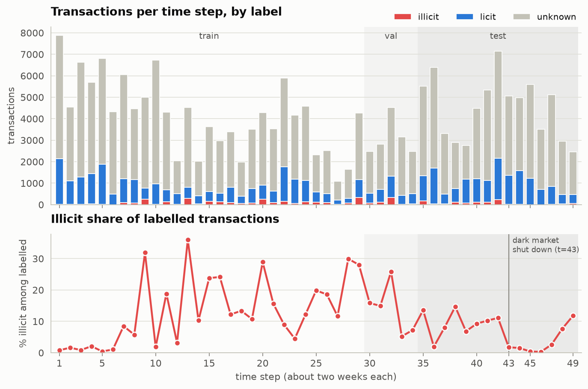
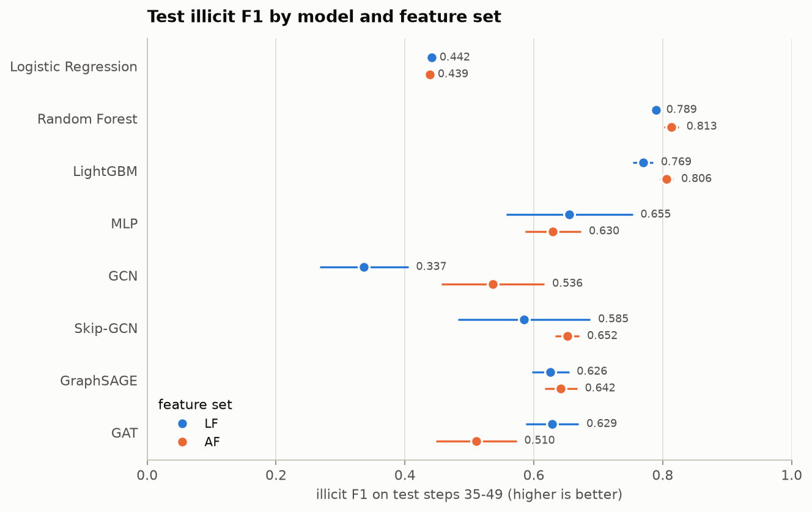
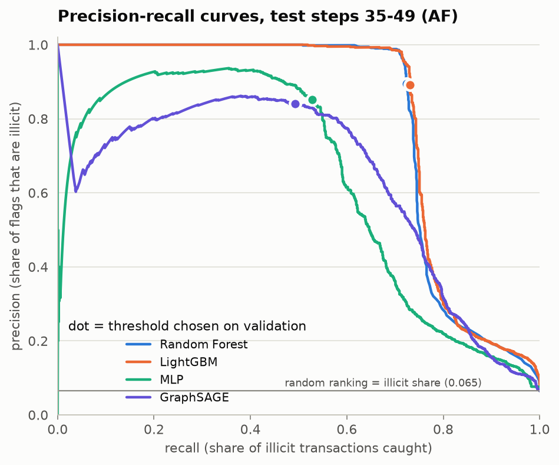
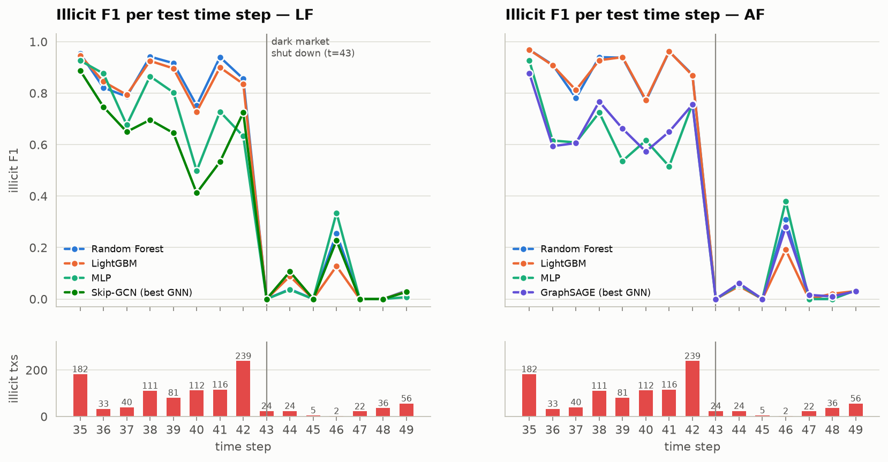
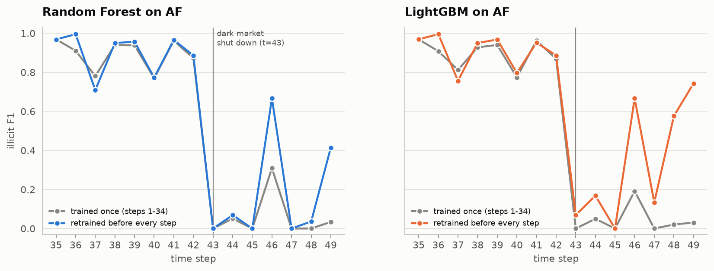
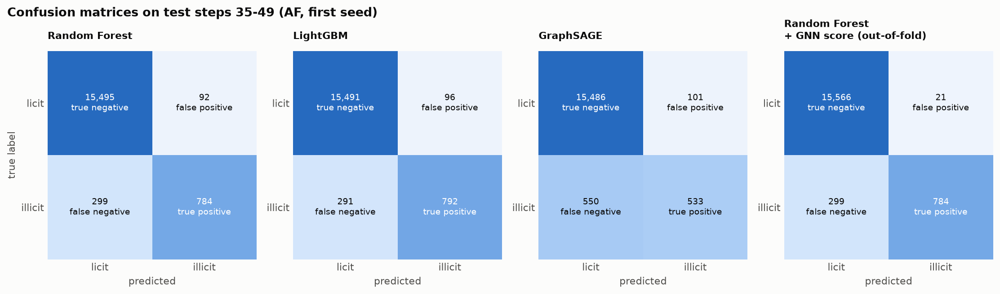
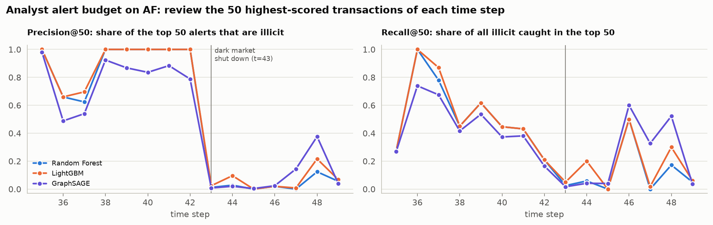
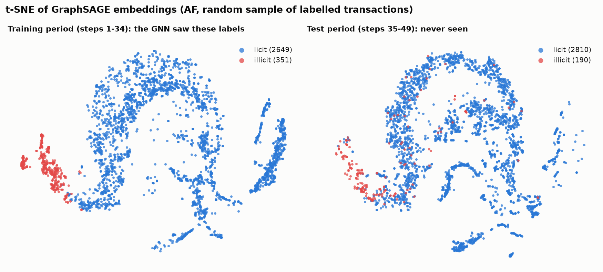
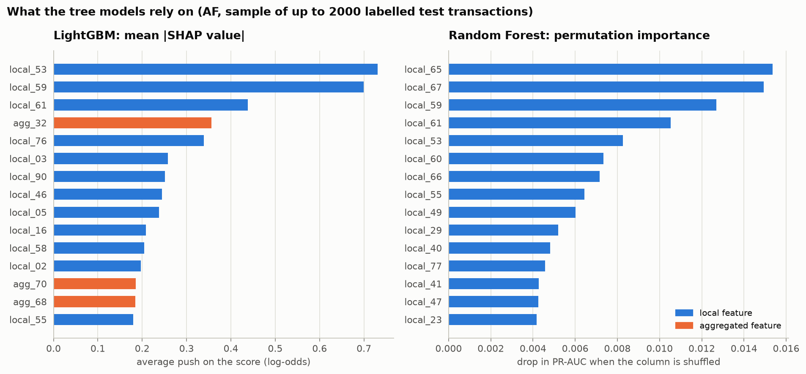
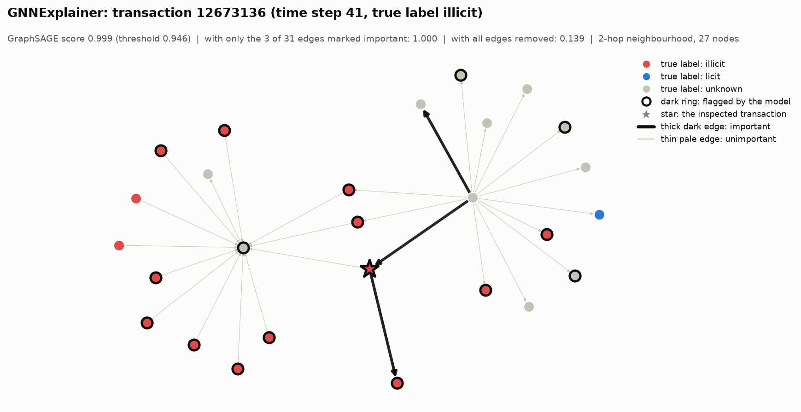

# FollowTheSats

**Detecting illicit Bitcoin transactions with Graph Neural Networks.** (A sat, short for satoshi, is the smallest unit of Bitcoin; the name is "follow the money" for a payment graph.)

Node classification on the [Elliptic dataset](https://www.kaggle.com/datasets/ellipticco/elliptic-data-set): given a Bitcoin transaction's features and its place in the payment graph, predict whether it is illicit. The project compares strong table models with graph neural networks under a strict temporal protocol and answers three questions with evidence:

1. Do GNNs beat Random Forest and gradient boosting on this data, and when?
2. Do GNN outputs improve tree models (hybrid approach)?
3. How much do models degrade over time, especially after the dark-market shutdown at time step 43, and what helps?

It ships with a Streamlit app for inspecting individual transactions, their neighbourhood and why they were flagged.

> New to the project? Read [`docs/EXPLAINER.md`](docs/EXPLAINER.md). It walks through the pipeline, the GNN equations, every design decision and 25 likely viva questions.

## Key findings

From the full run (5 seeds, CPU). Every number below is in the generated [results](#results) tables.

1. **GNNs do not beat the tree models here.** On all 165 features, Random Forest reaches illicit F1 0.813 ± 0.011 and LightGBM 0.806 ± 0.011 on the test period. The best GNN (Skip-GCN) reaches 0.652 ± 0.019. Random Forest on the 93 local features alone (0.789) beats every GNN. The original paper (Weber et al., 2019) also found Random Forest strongest (illicit F1 0.788, against 0.628 for GCN and 0.705 for Skip-GCN in its Table 1).
2. **The gap is "neural network versus trees", not "graph versus no graph".** An MLP with the same training loop and no graph scores 0.630 on AF, about the same as the GNNs. On the test period, removing every edge from a trained GNN changes fewer than 5% of its decisions, and in four of eight cases raises its PR-AUC. On the validation period the same GNNs clearly benefit from their edges, so what they learn about neighbourhoods does not carry over in time.
3. **A GNN on local features does not recover what the hand-made aggregated features give the trees.** The aggregated features are worth +0.024 F1 to Random Forest and +0.036 to LightGBM. GNNs on local features reach at most 0.629, below the MLP on the same features (0.655).
4. **GNN embeddings as extra tree features hurt** (Random Forest on AF: 0.813 → 0.652), because the embeddings of training rows come from a GNN trained on those rows. **An out-of-fold GNN score gives a small gain on AF** (Random Forest 0.827 ± 0.005, LightGBM 0.815 ± 0.002), about one standard deviation in size.
5. **Every model collapses at the dark-market shutdown (t = 43).** Random Forest's F1 is 0.906 on steps 35–42 and 0.030 on steps 43–49; its recall falls from 0.854 to 0.018. No static model exceeds 0.054 after the shutdown, and GNNs are no more robust than trees.
6. **Rolling retraining helps partly and late.** Retraining before every test step lifts LightGBM's F1 on steps 43–49 from 0.031 to 0.469 and Random Forest's from 0.030 to 0.183 (3 seeds). It cannot help at the moment of the change.
7. **Undirected edges work best** for the best GNN on AF (GraphSAGE): F1 0.642 undirected, 0.550 directed, 0.558 with separate weights per direction.
8. **A random split would have hidden most of this.** In one illustrative run it raises Random Forest from 0.800 to 0.940 and GraphSAGE from 0.621 to 0.901.
9. **Accuracy is useless here.** Predicting "licit" for everything is 93.50% accurate on the test period with an illicit F1 of 0.

## The data

| | |
|---|---|
| Transactions (nodes) | 203,769 |
| Payment flows (directed edges, A → B = an output of A is spent by B) | 234,355 |
| Labels | 4,545 illicit, 42,019 licit, 157,205 unknown |
| Features | 93 local + 72 aggregated one-hop neighbour features, anonymised |
| Time | 49 time steps about two weeks apart; each is one connected component, no edge crosses time steps |

Feature sets: **LF** = the 93 local features, **AF** = all 165. The transaction id and time step are never model inputs. Every fact in this table is asserted by the test suite.



## Approach

**Protocol** (the same code path for every model, `src/btc_aml/protocol.py`):

- Temporal split: train = steps 1–29, validation = 30–34, test = 35–49.
- Hyperparameters, early-stopping epoch and decision threshold are chosen on validation only.
- Final models are retrained on steps 1–34 and evaluated on the test steps once.
- Unknown-label nodes stay in the graph for message passing but are excluded from losses and metrics. Scalers are fitted on training time steps only.
- Metrics: illicit-class precision, recall and F1 (primary), PR-AUC, ROC-AUC; micro-F1 only for comparison with the original paper. Mean ± standard deviation over 5 seeds.
- Per-time-step illicit F1, and an analyst "alert budget": precision@K and recall@K among the labelled transactions of each test step.

**Models**

| Family | Models | Notes |
|---|---|---|
| Table baselines | Logistic Regression, Random Forest, LightGBM, MLP | class weights for imbalance |
| GNNs (PyTorch Geometric, full-batch, inductive) | GCN, Skip-GCN, GraphSAGE, GAT | weighted cross-entropy, Adam, dropout, early stopping on validation PR-AUC |
| Edge-direction ablation | undirected, directed, bidirectional (`DirGNNConv`) | on the best GNN |
| Hybrid | Random Forest / LightGBM on features + GNN embeddings, and on features + out-of-fold GNN score | GNN never trained on the evaluation period |
| Rolling retraining (stretch goal) | Random Forest, LightGBM | retrained before every test step |

**Explainability**: SHAP for LightGBM, permutation importance for Random Forest, GNNExplainer for individual GNN predictions drawn on the 2-hop neighbourhood. The features are anonymised, so explanations say *which* inputs mattered, not *what they mean*.

## Setup

Requires Python 3.10+ (built and tested with 3.12).

```bash
git clone https://github.com/theguyingreyhoodie/FollowTheSats.git
cd FollowTheSats
python -m venv .venv
source .venv/bin/activate            # Windows: .venv\Scripts\activate
pip install -r requirements.txt
```

- macOS only: LightGBM needs OpenMP from Homebrew: `brew install libomp`.
- For a CUDA build of PyTorch, install `torch` first with the command from pytorch.org, then run the line above. CUDA is used automatically when available; otherwise everything runs on CPU.
- No optional compiled PyG extensions (torch-scatter, torch-sparse, pyg-lib) are needed.

**Data.** Downloaded automatically on first run: through the Kaggle API if a Kaggle token is configured, otherwise through PyTorch Geometric's downloader. If both fail, download the three CSVs from the Kaggle page above and put them in `data/raw/`.

## Run

```bash
python run_all.py --config configs/quick.yaml    # everything, 1 seed, no search
python run_all.py --config configs/full.yaml     # everything, 5 seeds + hyperparameter search
pytest                                           # dataset facts, split integrity, metrics, models, app
streamlit run app/streamlit_app.py               # demo; loads saved artifacts, never trains
```

Single phases: `python run_all.py --config configs/full.yaml --only analysis,explain`, or run a module directly, e.g. `python -m btc_aml.train_gnn --config configs/quick.yaml`.

Measured on an Apple M5 laptop, CPU only: the quick config took 11.7 minutes (9.7 minutes in a second run from a fresh clone, including the data download) and the full config 150.8 minutes (per-phase times are in the last table of the results section). To keep the full run in that budget, the neural hyperparameter grids are small, the search uses one seed, and rolling retraining uses 3 seeds instead of 5.

Outputs: metrics in `results/metrics.csv` (one row per model, feature set, seed and split), per-time-step metrics in `results/per_timestep.csv`, figures in `results/figures/`, trained models in `models/`. If `results/` holds a run made with a different config, `run_all.py` first moves it to `archive/` instead of overwriting it.

## Results

All tables below are generated from `results/metrics.csv`; regenerate them with

```bash
python scripts/make_readme_table.py --config configs/full.yaml
```

<!-- RESULTS:START -->
_Everything between these markers is generated from `results/metrics.csv` by `python scripts/make_readme_table.py`. Do not edit by hand._

### Main results

Config `full`; values are mean ± standard deviation over 5 seeds.

**LF (93 local features), test steps 35-49**

| Model | Illicit precision | Illicit recall | Illicit F1 | PR-AUC | ROC-AUC | micro-F1 |
|---|---|---|---|---|---|---|
| Logistic Regression | 0.313 ± 0.000 | 0.751 ± 0.000 | 0.442 ± 0.000 | 0.286 ± 0.000 | 0.876 ± 0.000 | 0.877 ± 0.000 |
| Random Forest | 0.870 ± 0.013 | 0.722 ± 0.002 | 0.789 ± 0.004 | 0.789 ± 0.001 | 0.913 ± 0.003 | 0.975 ± 0.001 |
| LightGBM | 0.834 ± 0.049 | 0.716 ± 0.010 | 0.769 ± 0.016 | 0.788 ± 0.001 | 0.928 ± 0.001 | 0.972 ± 0.003 |
| MLP | 0.840 ± 0.135 | 0.570 ± 0.161 | 0.655 ± 0.098 | 0.681 ± 0.021 | 0.909 ± 0.003 | 0.963 ± 0.006 |
| GCN | 0.745 ± 0.071 | 0.223 ± 0.064 | 0.337 ± 0.068 | 0.466 ± 0.016 | 0.867 ± 0.003 | 0.944 ± 0.002 |
| Skip-GCN | 0.742 ± 0.055 | 0.501 ± 0.146 | 0.585 ± 0.103 | 0.583 ± 0.045 | 0.916 ± 0.004 | 0.956 ± 0.005 |
| GraphSAGE | 0.850 ± 0.046 | 0.497 ± 0.037 | 0.626 ± 0.029 | 0.654 ± 0.025 | 0.901 ± 0.002 | 0.961 ± 0.002 |
| GAT | 0.791 ± 0.044 | 0.527 ± 0.066 | 0.629 ± 0.041 | 0.631 ± 0.035 | 0.872 ± 0.024 | 0.960 ± 0.002 |

**AF (all 165 features), test steps 35-49**

| Model | Illicit precision | Illicit recall | Illicit F1 | PR-AUC | ROC-AUC | micro-F1 |
|---|---|---|---|---|---|---|
| Logistic Regression | 0.380 ± 0.000 | 0.520 ± 0.000 | 0.439 ± 0.000 | 0.267 ± 0.000 | 0.884 ± 0.000 | 0.914 ± 0.000 |
| Random Forest | 0.929 ± 0.031 | 0.724 ± 0.001 | 0.813 ± 0.011 | 0.797 ± 0.001 | 0.936 ± 0.002 | 0.978 ± 0.002 |
| LightGBM | 0.895 ± 0.029 | 0.733 ± 0.003 | 0.806 ± 0.011 | 0.805 ± 0.001 | 0.940 ± 0.001 | 0.977 ± 0.002 |
| MLP | 0.743 ± 0.096 | 0.552 ± 0.049 | 0.630 ± 0.044 | 0.595 ± 0.044 | 0.900 ± 0.004 | 0.958 ± 0.007 |
| GCN | 0.806 ± 0.172 | 0.442 ± 0.160 | 0.536 ± 0.080 | 0.652 ± 0.009 | 0.887 ± 0.006 | 0.953 ± 0.007 |
| Skip-GCN | 0.774 ± 0.048 | 0.566 ± 0.046 | 0.652 ± 0.019 | 0.643 ± 0.019 | 0.903 ± 0.002 | 0.961 ± 0.002 |
| GraphSAGE | 0.780 ± 0.036 | 0.548 ± 0.046 | 0.642 ± 0.025 | 0.615 ± 0.023 | 0.904 ± 0.007 | 0.960 ± 0.002 |
| GAT | 0.722 ± 0.162 | 0.405 ± 0.066 | 0.510 ± 0.063 | 0.570 ± 0.074 | 0.880 ± 0.007 | 0.950 ± 0.008 |

### LF versus AF

| Model | F1 on LF | F1 on AF | AF − LF (F1) | PR-AUC on LF | PR-AUC on AF | AF − LF (PR-AUC) |
|---|---|---|---|---|---|---|
| Logistic Regression | 0.442 ± 0.000 | 0.439 ± 0.000 | -0.003 | 0.286 ± 0.000 | 0.267 ± 0.000 | -0.018 |
| Random Forest | 0.789 ± 0.004 | 0.813 ± 0.011 | +0.024 | 0.789 ± 0.001 | 0.797 ± 0.001 | +0.008 |
| LightGBM | 0.769 ± 0.016 | 0.806 ± 0.011 | +0.036 | 0.788 ± 0.001 | 0.805 ± 0.001 | +0.018 |
| MLP | 0.655 ± 0.098 | 0.630 ± 0.044 | -0.026 | 0.681 ± 0.021 | 0.595 ± 0.044 | -0.086 |
| GCN | 0.337 ± 0.068 | 0.536 ± 0.080 | +0.200 | 0.466 ± 0.016 | 0.652 ± 0.009 | +0.186 |
| Skip-GCN | 0.585 ± 0.103 | 0.652 ± 0.019 | +0.067 | 0.583 ± 0.045 | 0.643 ± 0.019 | +0.060 |
| GraphSAGE | 0.626 ± 0.029 | 0.642 ± 0.025 | +0.016 | 0.654 ± 0.025 | 0.615 ± 0.023 | -0.039 |
| GAT | 0.629 ± 0.041 | 0.510 ± 0.063 | -0.118 | 0.631 ± 0.035 | 0.570 ± 0.074 | -0.061 |

### Edge-direction ablation

Model: GraphSAGE on AF.

| Edge treatment | Illicit precision | Illicit recall | Illicit F1 | PR-AUC (test) | PR-AUC (validation) |
|---|---|---|---|---|---|
| undirected | 0.780 ± 0.036 | 0.548 ± 0.046 | 0.642 ± 0.025 | 0.615 ± 0.023 | 0.955 ± 0.001 |
| directed | 0.576 ± 0.091 | 0.529 ± 0.050 | 0.550 ± 0.063 | 0.484 ± 0.051 | 0.867 ± 0.050 |
| bidirectional | 0.598 ± 0.022 | 0.524 ± 0.031 | 0.558 ± 0.024 | 0.547 ± 0.035 | 0.942 ± 0.004 |

### Hybrid: GNN output as extra tree features

The GNN is the one with the best validation PR-AUC on the same feature set.

| Tree model | Features | Input | Illicit precision | Illicit recall | Illicit F1 | ΔF1 vs features only | PR-AUC |
|---|---|---|---|---|---|---|---|
| Random Forest | LF | features only | 0.870 ± 0.013 | 0.722 ± 0.002 | 0.789 ± 0.004 |  | 0.789 ± 0.001 |
| Random Forest | LF | + Skip-GCN embeddings | 0.751 ± 0.047 | 0.652 ± 0.047 | 0.696 ± 0.013 | -0.094 | 0.735 ± 0.017 |
| Random Forest | LF | + Skip-GCN score (out-of-fold) | 0.885 ± 0.041 | 0.723 ± 0.007 | 0.795 ± 0.013 | +0.006 | 0.790 ± 0.001 |
| LightGBM | LF | features only | 0.834 ± 0.049 | 0.716 ± 0.010 | 0.769 ± 0.016 |  | 0.788 ± 0.001 |
| LightGBM | LF | + Skip-GCN embeddings | 0.822 ± 0.029 | 0.635 ± 0.018 | 0.716 ± 0.012 | -0.053 | 0.740 ± 0.009 |
| LightGBM | LF | + Skip-GCN score (out-of-fold) | 0.691 ± 0.194 | 0.707 ± 0.020 | 0.686 ± 0.091 | -0.083 | 0.768 ± 0.022 |
| Random Forest | AF | features only | 0.929 ± 0.031 | 0.724 ± 0.001 | 0.813 ± 0.011 |  | 0.797 ± 0.001 |
| Random Forest | AF | + GraphSAGE embeddings | 0.879 ± 0.025 | 0.519 ± 0.017 | 0.652 ± 0.019 | -0.161 | 0.664 ± 0.011 |
| Random Forest | AF | + GraphSAGE score (out-of-fold) | 0.964 ± 0.020 | 0.724 ± 0.006 | 0.827 ± 0.005 | +0.013 | 0.802 ± 0.002 |
| LightGBM | AF | features only | 0.895 ± 0.029 | 0.733 ± 0.003 | 0.806 ± 0.011 |  | 0.805 ± 0.001 |
| LightGBM | AF | + GraphSAGE embeddings | 0.781 ± 0.052 | 0.561 ± 0.026 | 0.652 ± 0.015 | -0.154 | 0.640 ± 0.018 |
| LightGBM | AF | + GraphSAGE score (out-of-fold) | 0.948 ± 0.007 | 0.714 ± 0.006 | 0.815 ± 0.002 | +0.009 | 0.813 ± 0.003 |

### Before and after the dark-market shutdown

| Model | Features | F1, steps 35-42 | Recall, steps 35-42 | Precision, steps 35-42 | F1, steps 43-49 | Recall, steps 43-49 | Precision, steps 43-49 |
|---|---|---|---|---|---|---|---|
| Logistic Regression | LF | 0.576 ± 0.000 | 0.872 ± 0.000 | 0.430 ± 0.000 | 0.035 ± 0.000 | 0.095 ± 0.000 | 0.021 ± 0.000 |
| Random Forest | LF | 0.887 ± 0.003 | 0.853 ± 0.003 | 0.924 ± 0.010 | 0.027 ± 0.001 | 0.018 ± 0.000 | 0.054 ± 0.005 |
| LightGBM | LF | 0.870 ± 0.011 | 0.844 ± 0.011 | 0.899 ± 0.034 | 0.033 ± 0.003 | 0.024 ± 0.004 | 0.058 ± 0.014 |
| MLP | LF | 0.762 ± 0.124 | 0.674 ± 0.190 | 0.925 ± 0.055 | 0.016 ± 0.009 | 0.012 ± 0.006 | 0.062 ± 0.057 |
| GCN | LF | 0.396 ± 0.083 | 0.262 ± 0.075 | 0.867 ± 0.048 | 0.015 ± 0.011 | 0.011 ± 0.008 | 0.032 ± 0.023 |
| Skip-GCN | LF | 0.700 ± 0.126 | 0.589 ± 0.172 | 0.907 ± 0.033 | 0.024 ± 0.003 | 0.022 ± 0.006 | 0.030 ± 0.010 |
| GraphSAGE | LF | 0.723 ± 0.031 | 0.585 ± 0.044 | 0.949 ± 0.022 | 0.032 ± 0.006 | 0.022 ± 0.005 | 0.057 ± 0.022 |
| GAT | LF | 0.717 ± 0.048 | 0.624 ± 0.079 | 0.855 ± 0.032 | 0.008 ± 0.008 | 0.005 ± 0.005 | 0.021 ± 0.029 |
| Logistic Regression | AF | 0.535 ± 0.000 | 0.601 ± 0.000 | 0.483 ± 0.000 | 0.054 ± 0.000 | 0.083 ± 0.000 | 0.040 ± 0.000 |
| Random Forest | AF | 0.906 ± 0.006 | 0.854 ± 0.002 | 0.963 ± 0.016 | 0.030 ± 0.002 | 0.018 ± 0.000 | 0.105 ± 0.048 |
| LightGBM | AF | 0.904 ± 0.008 | 0.865 ± 0.003 | 0.948 ± 0.019 | 0.031 ± 0.004 | 0.020 ± 0.003 | 0.065 ± 0.014 |
| MLP | AF | 0.715 ± 0.049 | 0.651 ± 0.058 | 0.801 ± 0.092 | 0.024 ± 0.003 | 0.017 ± 0.003 | 0.047 ± 0.013 |
| GCN | AF | 0.611 ± 0.091 | 0.522 ± 0.188 | 0.843 ± 0.142 | 0.015 ± 0.010 | 0.012 ± 0.013 | 0.088 ± 0.072 |
| Skip-GCN | AF | 0.753 ± 0.024 | 0.668 ± 0.054 | 0.869 ± 0.040 | 0.020 ± 0.006 | 0.015 ± 0.003 | 0.031 ± 0.012 |
| GraphSAGE | AF | 0.729 ± 0.029 | 0.646 ± 0.054 | 0.842 ± 0.041 | 0.026 ± 0.001 | 0.018 ± 0.000 | 0.051 ± 0.008 |
| GAT | AF | 0.575 ± 0.073 | 0.479 ± 0.077 | 0.746 ± 0.156 | 0.004 ± 0.005 | 0.002 ± 0.003 | 0.010 ± 0.014 |
| Random Forest — rolling retraining | AF | 0.914 ± 0.002 | 0.850 ± 0.005 | 0.988 ± 0.003 | 0.183 ± 0.064 | 0.105 ± 0.039 | 0.763 ± 0.084 |
| LightGBM — rolling retraining | AF | 0.917 ± 0.002 | 0.865 ± 0.008 | 0.976 ± 0.011 | 0.469 ± 0.070 | 0.323 ± 0.068 | 0.872 ± 0.001 |

### Rolling retraining

| Model | Training | Illicit precision | Illicit recall | Illicit F1 | PR-AUC | Seeds |
|---|---|---|---|---|---|---|
| Random Forest | trained once on steps 1-34 | 0.929 ± 0.031 | 0.724 ± 0.001 | 0.813 ± 0.011 | 0.797 ± 0.001 | 5 |
| Random Forest | retrained before every test step | 0.982 ± 0.003 | 0.734 ± 0.010 | 0.840 ± 0.006 | 0.899 ± 0.001 | 3 |
| LightGBM | trained once on steps 1-34 | 0.895 ± 0.029 | 0.733 ± 0.003 | 0.806 ± 0.011 | 0.805 ± 0.001 | 5 |
| LightGBM | retrained before every test step | 0.969 ± 0.012 | 0.781 ± 0.017 | 0.865 ± 0.006 | 0.916 ± 0.001 | 3 |

### Alert budget (top 50 per time step)

| Model | Features | Precision@50, steps 35-42 | Recall@50, steps 35-42 | Precision@50, steps 43-49 | Recall@50, steps 43-49 |
|---|---|---|---|---|---|
| Logistic Regression | LF | 0.182 | 0.089 | 0.049 | 0.133 |
| Random Forest | LF | 0.903 | 0.517 | 0.032 | 0.113 |
| LightGBM | LF | 0.909 | 0.523 | 0.033 | 0.134 |
| MLP | LF | 0.863 | 0.500 | 0.042 | 0.120 |
| GCN | LF | 0.646 | 0.332 | 0.035 | 0.069 |
| Skip-GCN | LF | 0.820 | 0.468 | 0.054 | 0.163 |
| GraphSAGE | LF | 0.837 | 0.470 | 0.059 | 0.166 |
| GAT | LF | 0.792 | 0.424 | 0.025 | 0.032 |
| Logistic Regression | AF | 0.305 | 0.153 | 0.097 | 0.265 |
| Random Forest | AF | 0.911 | 0.526 | 0.034 | 0.115 |
| LightGBM | AF | 0.919 | 0.537 | 0.062 | 0.161 |
| MLP | AF | 0.754 | 0.419 | 0.095 | 0.251 |
| GCN | AF | 0.783 | 0.416 | 0.082 | 0.237 |
| Skip-GCN | AF | 0.819 | 0.450 | 0.072 | 0.243 |
| GraphSAGE | AF | 0.788 | 0.444 | 0.088 | 0.226 |
| GAT | AF | 0.686 | 0.351 | 0.065 | 0.171 |

### Do the GNNs use the graph?

Each trained GNN scores its evaluation graph twice: normally, and with every edge removed (each node then sees only its own features). Nothing is retrained. Validation = model trained on steps 1-29 scored on steps 30-34; test = model trained on steps 1-34 scored on steps 35-49.

| Model | Features | Validation PR-AUC, with edges | Validation PR-AUC, edges removed | Test PR-AUC, with edges | Test PR-AUC, edges removed | Test F1, with edges | Test F1, edges removed | Test decisions that change |
|---|---|---|---|---|---|---|---|---|
| GCN | LF | 0.917 ± 0.006 | 0.888 ± 0.010 | 0.466 ± 0.016 | 0.607 ± 0.054 | 0.337 ± 0.068 | 0.633 ± 0.068 | 4.3% |
| Skip-GCN | LF | 0.964 ± 0.004 | 0.909 ± 0.009 | 0.583 ± 0.045 | 0.483 ± 0.050 | 0.585 ± 0.103 | 0.596 ± 0.040 | 4.7% |
| GraphSAGE | LF | 0.957 ± 0.002 | 0.819 ± 0.030 | 0.654 ± 0.025 | 0.544 ± 0.033 | 0.626 ± 0.029 | 0.676 ± 0.022 | 2.5% |
| GAT | LF | 0.905 ± 0.008 | 0.869 ± 0.028 | 0.631 ± 0.035 | 0.700 ± 0.016 | 0.629 ± 0.041 | 0.739 ± 0.022 | 3.0% |
| GCN | AF | 0.891 ± 0.013 | 0.790 ± 0.029 | 0.652 ± 0.009 | 0.605 ± 0.033 | 0.536 ± 0.080 | 0.648 ± 0.059 | 4.1% |
| Skip-GCN | AF | 0.935 ± 0.012 | 0.843 ± 0.016 | 0.643 ± 0.019 | 0.530 ± 0.032 | 0.652 ± 0.019 | 0.624 ± 0.022 | 3.4% |
| GraphSAGE | AF | 0.955 ± 0.001 | 0.763 ± 0.008 | 0.615 ± 0.023 | 0.650 ± 0.026 | 0.642 ± 0.025 | 0.667 ± 0.022 | 2.7% |
| GAT | AF | 0.928 ± 0.006 | 0.872 ± 0.034 | 0.570 ± 0.074 | 0.637 ± 0.038 | 0.510 ± 0.063 | 0.652 ± 0.041 | 2.5% |

### Threshold diagnostic

The last two F1 columns are diagnostics, **not results**: the oracle threshold is chosen with test labels and is only an upper bound on what a better threshold could achieve.

| Model | Features | Mean threshold (from validation) | F1 at validation threshold (reported) | F1 at threshold 0.5 | F1 at oracle test threshold (upper bound) | Oracle − reported |
|---|---|---|---|---|---|---|
| Logistic Regression | LF | 0.810 | 0.442 ± 0.000 | 0.258 ± 0.000 | 0.559 ± 0.000 | +0.117 |
| Random Forest | LF | 0.428 | 0.789 ± 0.004 | 0.800 ± 0.002 | 0.803 ± 0.001 | +0.013 |
| LightGBM | LF | 0.758 | 0.769 ± 0.016 | 0.700 ± 0.042 | 0.795 ± 0.005 | +0.026 |
| MLP | LF | 0.929 | 0.655 ± 0.098 | 0.471 ± 0.036 | 0.758 ± 0.024 | +0.102 |
| GCN | LF | 0.912 | 0.337 ± 0.068 | 0.412 ± 0.027 | 0.459 ± 0.009 | +0.122 |
| Skip-GCN | LF | 0.931 | 0.585 ± 0.103 | 0.537 ± 0.050 | 0.664 ± 0.009 | +0.079 |
| GraphSAGE | LF | 0.943 | 0.626 ± 0.029 | 0.563 ± 0.048 | 0.671 ± 0.013 | +0.045 |
| GAT | LF | 0.893 | 0.629 ± 0.041 | 0.384 ± 0.010 | 0.637 ± 0.035 | +0.008 |
| Logistic Regression | AF | 0.949 | 0.439 ± 0.000 | 0.315 ± 0.000 | 0.446 ± 0.000 | +0.007 |
| Random Forest | AF | 0.367 | 0.813 ± 0.011 | 0.817 ± 0.003 | 0.827 ± 0.002 | +0.014 |
| LightGBM | AF | 0.555 | 0.806 ± 0.011 | 0.802 ± 0.007 | 0.828 ± 0.001 | +0.022 |
| MLP | AF | 0.796 | 0.630 ± 0.044 | 0.616 ± 0.028 | 0.639 ± 0.036 | +0.010 |
| GCN | AF | 0.695 | 0.536 ± 0.080 | 0.630 ± 0.013 | 0.641 ± 0.012 | +0.105 |
| Skip-GCN | AF | 0.783 | 0.652 ± 0.019 | 0.642 ± 0.014 | 0.662 ± 0.018 | +0.010 |
| GraphSAGE | AF | 0.880 | 0.642 ± 0.025 | 0.631 ± 0.026 | 0.657 ± 0.023 | +0.015 |
| GAT | AF | 0.899 | 0.510 ± 0.063 | 0.571 ± 0.039 | 0.578 ± 0.041 | +0.067 |

### Random split versus temporal split

One run each (first seed). The random-split column is an illustration of leakage, not a result.

| Model | Features | F1, temporal split (real protocol, same seed) | F1, random split (leaky) | Inflation |
|---|---|---|---|---|
| Random Forest | AF | 0.800 | 0.940 | +0.140 |
| GraphSAGE | AF | 0.621 | 0.901 | +0.280 |

### Trivial baseline

| Split | Illicit | Licit | Illicit share of labelled | Accuracy of 'everything is licit' | Illicit F1 of 'everything is licit' |
|---|---|---|---|---|---|
| train | 2,871 | 23,510 | 10.88% | 89.12% | 0.000 |
| val | 591 | 2,922 | 16.82% | 83.18% | 0.000 |
| test | 1,083 | 15,587 | 6.50% | 93.50% | 0.000 |

### Run time

Config `full`, 5 seed(s), device `cpu`, Darwin arm64, 10 CPU cores, Python 3.12.16.

| Phase | Seconds | Minutes |
|---|---|---|
| data | 0 s | 0.0 min |
| eda | 0 s | 0.0 min |
| baselines | 805 s | 13.4 min |
| gnn | 4706 s | 78.4 min |
| ablation | 663 s | 11.0 min |
| hybrid | 2146 s | 35.8 min |
| rolling | 531 s | 8.8 min |
| random_split | 148 s | 2.5 min |
| analysis | 13 s | 0.2 min |
| explain | 36 s | 0.6 min |
| **total** | 9048 s | 150.8 min |
<!-- RESULTS:END -->

## Figures

| | |
|---|---|
|  |  |
| Test illicit F1 of every model on both feature sets | Precision-recall curves on the test period (AF) |



*Illicit F1 for each test time step. Every model collapses at the dark-market shutdown (t = 43). The bottom strip shows how few illicit transactions the late steps contain.*



*Retraining before every test step (colour) against training once (grey).*







*t-SNE of the best GNN's embeddings: training period on the left, unseen test period on the right.*

| | |
|---|---|
|  |  |
| What the tree models rely on | GNNExplainer on one flagged transaction |

More figures (class balance, degree distribution, further explanations) are in `results/figures/`.

## The app

```bash
streamlit run app/streamlit_app.py
```

- **Overview**: dataset statistics and label distribution over time.
- **Model comparison**: results table and per-time-step chart.
- **Transaction inspector**: pick a test transaction (or a random illicit / flagged / licit one); see its true label, every model's probability, its 2-hop neighbourhood coloured by label and flag, the most important payment flows (GNNExplainer) and the feature contributions (SHAP).
- **Time travel**: slide through the test time steps and watch F1 and the alert-budget metrics change.

The app reads whatever run is in `results/` and `models/`, so run the pipeline first.

## Project layout

```
configs/            quick.yaml (1 seed, minutes) and full.yaml (5 seeds)
src/btc_aml/
  data.py           download, validate, cache
  splits.py         temporal split, scaling, per-split graphs
  evaluate.py       metrics, threshold tuning, result files
  protocol.py       the two-phase evaluation protocol shared by all models
  models.py         MLP, GCN, Skip-GCN, GraphSAGE, GAT
  neural.py         training loop for the MLP and GNNs
  train_baselines.py, train_gnn.py, hybrid.py, rolling.py, random_split.py
  eda.py, analysis.py, explain.py, plotting.py, report.py
app/streamlit_app.py
tests/              dataset facts, split integrity, metrics, models, app smoke test
scripts/make_readme_table.py
docs/EXPLAINER.md
run_all.py
```

## Limitations

- Features are anonymised, which limits both feature engineering and interpretation.
- Only 23% of transactions are labelled, and not at random; all metrics are measured on labelled transactions.
- The publisher standardised the features over the whole dataset including the test period, a small leak that cannot be undone.
- The validation period is short (five time steps), so threshold and early-stopping choices are noisy; the threshold diagnostic table quantifies the cost.
- GNNExplainer's edge masks are only meaningful when the neighbourhood matters for a prediction; for most test transactions it does not, and the app says so.
- The hyperparameter search is small and uses one seed.
- The GNNs are static: each time step is a separate graph and the models have no notion of time.
- Rolling retraining assumes labels arrive within one time step, which is optimistic.
- False positives matter: a flag can freeze an innocent person's funds. These models are suited to ranking cases for human review, not to automatic decisions. See the ethics section of the explainer.

## Future work

- A temporal GNN such as EvolveGCN.
- Self-training with high-confidence pseudo-labels on the unknown nodes.
- Drift detection to trigger retraining, instead of retraining on a fixed schedule.
- Wallet-level detection with the Elliptic++ dataset.
- Probability calibration and cost-sensitive thresholds (a false positive and a false negative do not cost the same).

## Reference

M. Weber, G. Domeniconi, J. Chen, D. K. I. Weidele, C. Bellei, T. Robinson, C. E. Leiserson. *Anti-Money Laundering in Bitcoin: Experimenting with Graph Convolutional Networks for Financial Forensics.* KDD '19 Workshop on Anomaly Detection in Finance. [arXiv:1908.02591](https://arxiv.org/abs/1908.02591)
